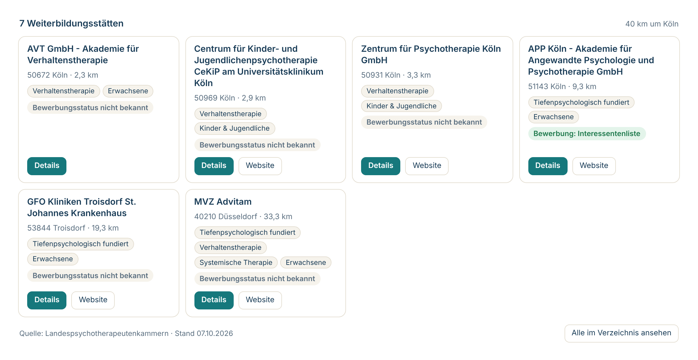

# PT-Weiterbildung

Find training sites for the psychotherapy specialist training in Germany (Psychotherapie-Weiterbildung) directly
in Claude or ChatGPT. The plugin connects your assistant to pt-weiterbildung.de, which combines the official lists
of accredited training sites (Weiterbildungsstätten) from all 16 Landespsychotherapeutenkammern and updates them
daily.

## What it does

- **Search training sites** by city or postal code with a radius, by Bundesland, therapy method (Verfahren),
  patient group (adults, children and adolescents), care setting (ambulant, stationär, institutionell) and
  whether a site currently accepts applications.
- **What is new**: training sites that are new in the directory or now accept applications since a date,
  with the same filters; usable for a weekly check-in instead of an e-mail alert.
- **Show one site in detail**: addresses, institutional contact, every accredited method with its training
  duration and, where known, the application route, next date, part-time options, pay and fees.
- **Numbers**: how many training sites exist in Germany and per Bundesland, by method and patient group.
- **Guides and FAQ**: how the five-year training works, pay of PiW, financing and applications.

Three skills tell the assistant how to use these tools: `weiterbildungsplatz-finden` for finding and applying to
a place, `neue-stellen-verfolgen` for keeping track of new positions, and `fragen-zur-weiterbildung` for
questions about the training itself.

## Install

- **Claude (claude.ai, Cowork):** from the plugin directory, or Customize > Plugins > Add > Add marketplace with
  `calvin-as/pt-weiterbildung-ki-plugin`; then connect the bundled PT-Weiterbildung connector.
- **Claude Code:** `/plugin marketplace add calvin-as/pt-weiterbildung-ki-plugin`, then
  `/plugin install pt-weiterbildung@pt-weiterbildung`.
- **ChatGPT:** from the plugin directory once published.
- **Connector only:** add `https://www.pt-weiterbildung.de/mcp` as a custom connector.

## How to use it

Connect the bundled PT-Weiterbildung connector (no account or sign-in needed). Then ask, for example:

- "Finde Weiterbildungsstätten für Verhaltenstherapie im Umkreis von 30 km um Köln."
- "Wo kann ich mich gerade für die Weiterbildung mit Kindern und Jugendlichen in Bayern bewerben?"
- "Was verdient man als Psychotherapeut:in in Weiterbildung?"
- "Was gibt es seit letzter Woche Neues für Verhaltenstherapie in Hamburg?"

In Claude and ChatGPT, search results also appear as cards with location, methods and application status.

## Data

The connector talks only to `https://www.pt-weiterbildung.de/mcp`. It sends the search parameters the assistant
chooses for your question (for example place, Bundesland, method or a search term) and receives public directory
data. pt-weiterbildung.de does not require an account, sets no cookies, does not store search parameters and keeps
only an anonymous daily count per tool. All tools are read-only.

- Documentation: https://www.pt-weiterbildung.de/ki-assistenten
- Privacy policy: https://www.pt-weiterbildung.de/datenschutz#ki-connector
- Terms: https://www.pt-weiterbildung.de/nutzungsbedingungen
- Support: ptweiterbildung@gmail.com

Application status comes from the training sites or from checks of their websites and can change at short
notice; the Landespsychotherapeutenkammern are the authoritative source for accreditation.

## Deutsch

PT-Weiterbildung bringt das Verzeichnis der Weiterbildungsstätten für die Psychotherapie-Weiterbildung von
pt-weiterbildung.de in Claude und ChatGPT: Suche nach Ort und Umkreis, Verfahren, Gebiet und Bewerbungsstatus,
Details zur Bewerbung, Zahlen je Bundesland sowie Ratgeber zu Ablauf, Gehalt und Finanzierung. Kostenlos, ohne
Login, nur lesend.
